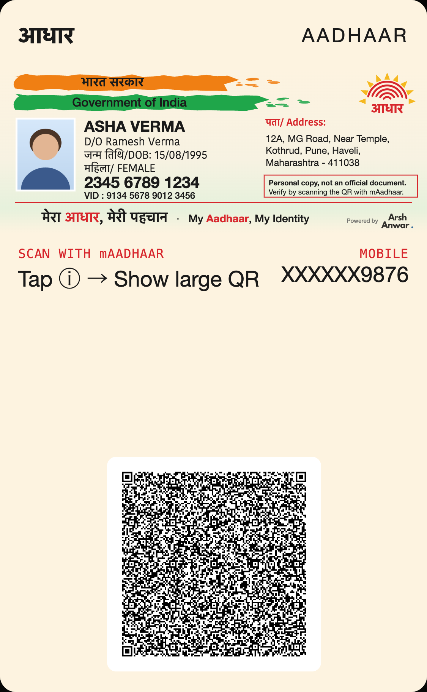
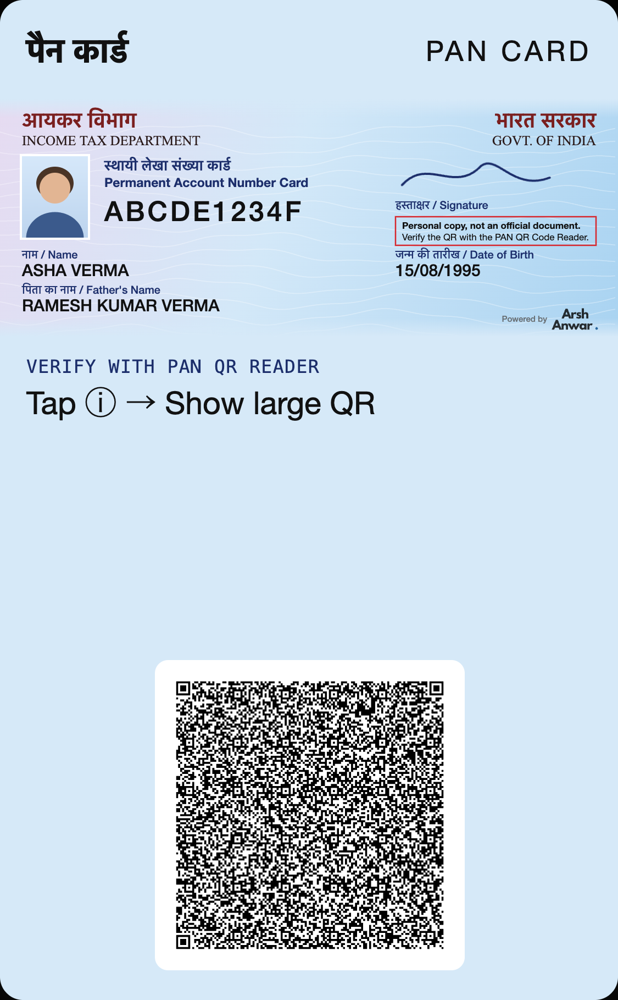
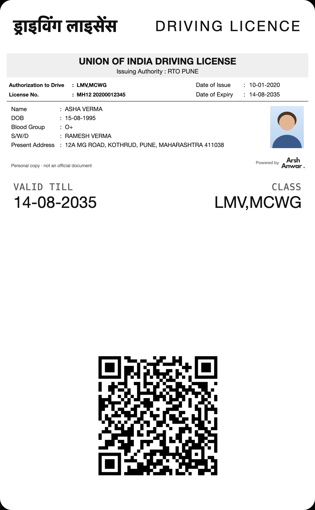
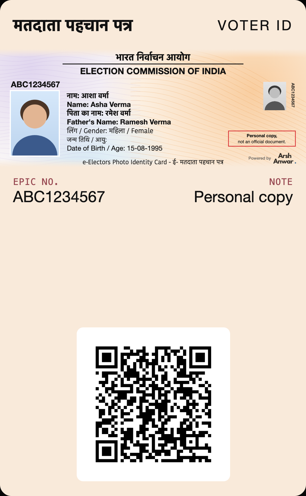
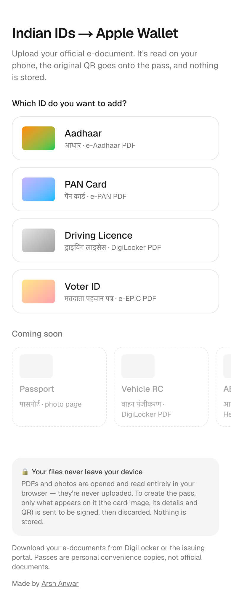
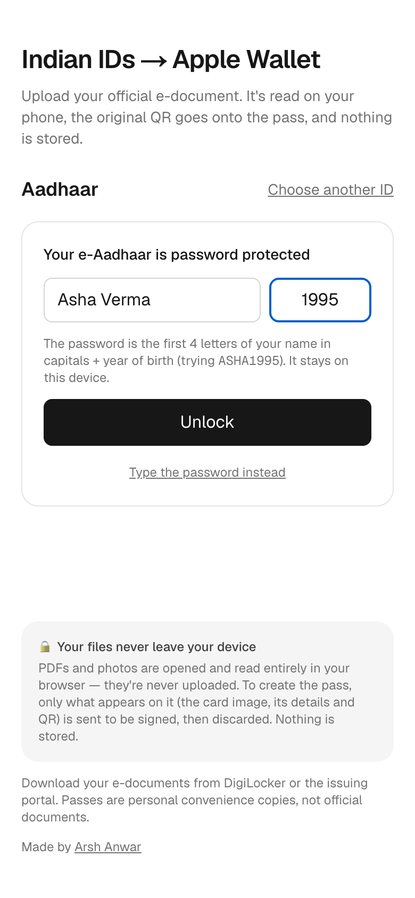
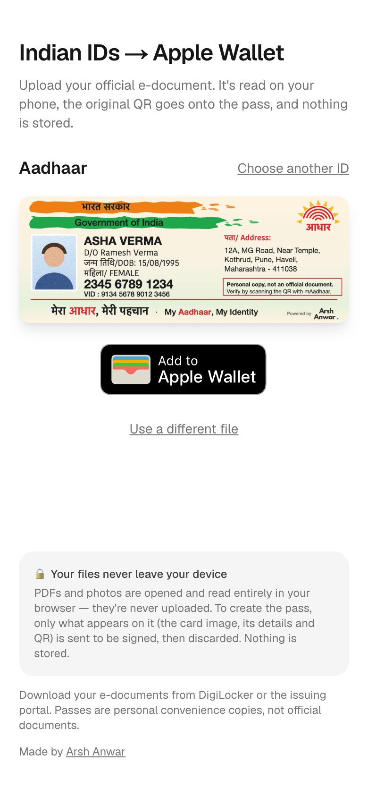
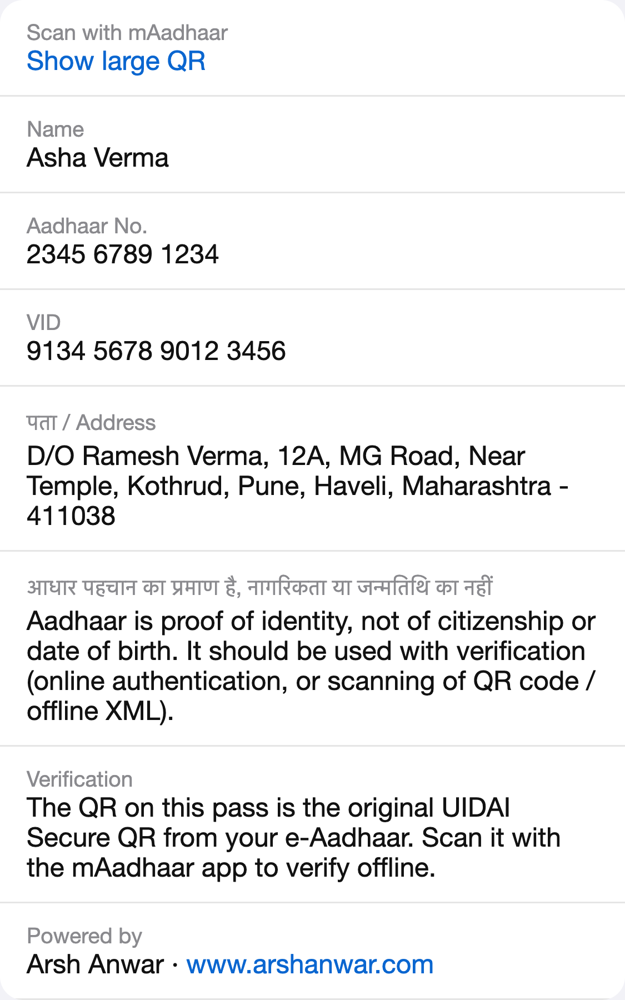

# Indian IDs → Apple Wallet

Turn your official Indian e-documents — **Aadhaar, PAN, Driving Licence and Voter ID** — into Apple Wallet passes that look like the real card and carry the document's original, verifiable QR.

**Live:** [ids-applewallet.arshanwar.me](https://ids-applewallet.arshanwar.me)

Your files are read entirely in your browser and never uploaded. See [Privacy](#privacy).

https://github.com/user-attachments/assets/929a4d4e-8448-4bc7-b915-6a9f55ab9294

<p align="center">
  
  
  
  
</p>

<sub>All screenshots use made-up sample data ("Asha Verma"), not a real person.</sub>

## Why I built this

In the US, Apple Wallet supports government IDs: in participating states you can add your driver's licence or state ID right next to your cards, and it just works. I've had my IDs in Apple Wallet for a while, and it's genuinely the most convenient way to carry them.

For Indian IDs there's nothing like that. Showing your Aadhaar, PAN, driving licence or voter ID means digging through photos and screenshots, or opening a separate app for each one: DigiLocker, mAadhaar, mParivahan, and so on. It works, but it's often cumbersome, especially when you just need to show an ID quickly. The government is doing a lot to digitise IDs, but there's still no way to keep them in Wallet the way you keep a boarding pass or a payment card.

Apple Pay launched in India in October 2026, 12 years after it first launched in the US, which means a lot more people here will be opening Apple Wallet every day. Android users can already store some IDs in their phone's wallet, but on iOS there was nothing. Since I already keep IDs in Apple Wallet, it made sense to build the same for Indian IDs.

So this project takes the official e-documents you can already download (e-Aadhaar, e-PAN, DigiLocker DL, e-EPIC), turns each one into a Wallet pass that looks like the real card, and keeps the original government QR on it so it can still be verified with the official apps.

---

## How it works

<p align="center">
  
  
  
  
</p>

1. **Pick your ID** and upload the official e-document (download links are on each screen).
2. **Unlock it** if it's password-protected — the site builds the password for you (e.g. name + birth year for e-Aadhaar, date of birth for e-PAN). The password never leaves the device.
3. **Check the preview.** Details are read from the document; where a field can't be read reliably you get an editable form, and the card redraws as you type.
4. **Tap Add to Apple Wallet.** The pass is signed and Safari opens the Wallet sheet.

On the back of each pass (ⓘ) you'll find every detail in full, how to verify the QR, and for dense QRs (Aadhaar, PAN) a **Show large QR** link that displays the code full-screen so verifier apps can scan it.

**Something not read correctly?** Every PAN, Voter ID and Driving Licence flow (PDF or photo) has a *Report it privately* panel. It builds a reading report on the device describing only the document's layout — page size, text layer, image sizes and roles, QR length, issuer keywords, which fields were found and (for OCR) confidence per field and region — with no names, numbers, photos or document text. You can review it, copy it, or open a prefilled GitHub issue.

## Supported IDs

| ID | Upload | Where to get it | Unlock | What's read | QR on the pass |
|---|---|---|---|---|---|
| **Aadhaar** | e-Aadhaar PDF (or a photo of its QR) | [myAadhaar](https://myaadhaar.uidai.gov.in/genricDownloadAadhaar) or DigiLocker | First 4 letters of name + birth year | UIDAI Secure QR: name, DOB, gender, C/O, address, photo; full number and VID from the PDF | Original UIDAI Secure QR — verify with **mAadhaar** |
| **PAN** | e-PAN PDF (or a photo of the card) | [UTIITSL](https://www.pan.utiitsl.com/PAN_ONLINE/ePANCardHome) / [Protean (NSDL)](https://onlineservices.proteantech.in/paam/requestAndDownloadEPAN.html) | Date of birth (DDMMYYYY) | PAN, name, father's name, DOB, photo, signature | Original PAN QR, byte-for-byte — verify with **PAN QR Code Reader** |
| **Driving Licence** | DigiLocker DL PDF (or photos of the card) | [DigiLocker](https://www.digilocker.gov.in/) → Issued Documents | — | All licence fields and photo; from card photos via on-device OCR (editable, add your own photo) | Original DigiLocker QR — verify with **DigiLocker** |
| **Voter ID** | e-EPIC PDF (or photos of the card, front + back) | [ECI voters portal](https://voters.eci.gov.in/home/e-epic-download) | — | EPIC no., names (Hindi + English), gender, DOB, address, ERO, constituency, part, serial — via on-device OCR for image-only e-EPICs | Original e-EPIC QR — verify with **ECINET** |

**Coming soon:** Passport, Vehicle RC, ABHA Health Card, Ayushman Card, e-Shram Card.

Passes are **personal convenience copies, not official documents** — every card says so, and verification always goes through the original QR and the issuer's own app.

## Privacy

- **Your files never leave your device.** PDFs and photos are opened, unlocked and read in the browser: [pdf.js](https://mozilla.github.io/pdf.js/) for PDFs, [zxing-wasm](https://github.com/Sec-ant/zxing-wasm) for QR codes, and [Tesseract](https://github.com/naptha/tesseract.js) for OCR (English + Hindi). All of these are served from this site — no third-party CDNs.
- **Only the pass contents are sent to the server** — the card image, the details shown on it and the QR — because an Apple Wallet pass has to be signed with a certificate that can't live in the browser. The server signs the pass and streams it back; pass contents are never stored or logged.
- **Anonymous usage & consent log.** Each terms acceptance and pass creation is recorded with only: event type, ID type, terms version, timestamps, a random consent ID generated in the browser, and country. No names, numbers, photos, QR contents, images or IP addresses. Kept up to 3 years (Upstash Redis; optional — skipped if not configured).
- The one cookie the site sets is a random token used to stop the "Creating your pass…" spinner.
- Using the site requires accepting the terms (first-visit dialog + a confirmation on every upload); the pass endpoints refuse to sign without the current terms version.

```
 Your device (browser)                                      Server (one stateless function)
 ┌──────────────────────────────────────────────┐          ┌──────────────────────────────────┐
 │ PDF / photo ─▶ unlock ─▶ read QR, text, photo│          │ validate ─▶ build pass ─▶ sign   │
 │              (pdf.js, zxing-wasm, Tesseract) │  card +  │ with Pass Type ID certificate    │
 │ ─▶ draw card ─▶ you review / edit ───────────┼─ QR ────▶│ ─▶ return .pkpass, store nothing │
 └──────────────────────────────────────────────┘          └──────────────────────────────────┘
```

---

## Run your own

### 1. Get an Apple Pass Type ID certificate

You need a paid [Apple Developer Program](https://developer.apple.com/programs/) membership (individual or organisation). The organisation name on the certificate shows in each pass's certificate details.

1. **Create a Pass Type ID** — [developer.apple.com](https://developer.apple.com/account/resources/identifiers/list/passTypeId) → Certificates, Identifiers & Profiles → Identifiers → **+** → **Pass Type IDs**. Use an identifier like `pass.com.yourname.idwallet`.
2. **Make a certificate signing request (CSR)** on your Mac — Keychain Access → menu **Keychain Access → Certificate Assistant → Request a Certificate From a Certificate Authority** → enter your email, choose **Saved to disk**.
3. **Create the certificate** — open your Pass Type ID → **Create Certificate** → upload the CSR → download `pass.cer`.
4. **Export a .p12** — double-click `pass.cer` to add it to Keychain → **My Certificates** → expand "Pass Type ID: …" so the private key shows → right-click → **Export** → `.p12` with a password. Keep it outside the repo.
5. **Find your Team ID** — on your [Membership](https://developer.apple.com/account#MembershipDetailsCard) page (10 characters).

Then convert the `.p12` into the PEM files the server uses (they go to `./certs`, which is gitignored; it asks for the p12 password and downloads Apple's WWDR intermediate certificate):

```sh
scripts/setup-certs.sh ~/path/to/pass.p12
```

> Never commit `certs/`, `.p12`, `.pem` or `.env*` files — they're all in `.gitignore`.

### 2. Run locally

Requires Node 22+.

```sh
npm install                       # also copies pdf.js / zxing / Tesseract assets into public/vendor
cp .env.example .env.local        # set PASS_TYPE_ID, TEAM_ID, ORGANIZATION_NAME
npm run dev                       # http://localhost:3000
```

`/preview` (dev only) renders every card design with sample data.

**Testing on an iPhone:** Safari needs to reach your Mac. On the same Wi-Fi use `http://<your-mac-ip>:3000`, or get HTTPS with [Tailscale](https://tailscale.com/kb/1312/serve) (`tailscale serve --bg 3000`, tailnet-only) or a tunnel such as `cloudflared tunnel --url http://localhost:3000`. Set `PUBLIC_URL` to that address so "Show large QR" links work.

### 3. Deploy to Vercel

1. Import the repository in Vercel (framework: Next.js; no build settings to change).
2. Generate the environment file from your certificates:
   ```sh
   scripts/vercel-env.sh pass.com.yourname.idwallet YOURTEAMID "Your Name" https://your-domain
   ```
3. In **Project → Settings → Environment Variables**, paste the contents of `.env.vercel` (or use **Import .env**). Mark `PASS_SIGNER_KEY_B64` as **Sensitive**.
4. Deploy, then delete `.env.vercel`.

| Variable | Purpose |
|---|---|
| `PASS_TYPE_ID`, `TEAM_ID` | From your Apple Developer account |
| `ORGANIZATION_NAME` | Shown as the pass issuer in Wallet |
| `PUBLIC_URL` | Base URL for "Show large QR" links (falls back to the request's own origin) |
| `PASS_SIGNER_CERT_B64`, `PASS_SIGNER_KEY_B64`, `PASS_WWDR_B64` | Base64 of the PEMs in `certs/` (locally, the PEM files are read directly instead) |
| `KV_REST_API_URL`, `KV_REST_API_TOKEN` | *Optional.* Upstash Redis for the anonymous usage & consent log — added automatically by Vercel → Storage → Upstash |
| `STATS_TOKEN` | *Optional.* Secret (16+ chars) for `GET /api/stats` with `Authorization: Bearer <token>`; add `?audit=YYYY-MM-DD` for that day's records |

---

## Project layout

```
src/app/                    UI: ID picker, one flow per ID, welcome/terms dialog, /terms, /qr (large QR), /preview (dev)
src/app/api/pass/<id>/      Pass signing endpoints (aadhaar, pan, dl, voter)
src/lib/<id>/               Per-ID parsing: Aadhaar Secure QR, PAN/DL/e-EPIC text, voter OCR
src/lib/client/             Browser-only: document scanning, photo/signature detection, OCR, card renderers
src/lib/pass/               Server-only: certificate loading, pass layouts, HTTP helpers
pass-model/                 Pass icons
public/badges/              Apple's official "Add to Apple Wallet" badge (used unmodified)
public/brand/               Logo for the "Powered by" mark
scripts/                    Certificate setup, Vercel env generation, vendor asset copy
tests/                      Parser tests (node --test)
```

```sh
npm test        # parser tests
npm run lint
```

## Disclaimer

Using the site requires accepting its [Terms of Use & Privacy](https://ids-applewallet.arshanwar.me/terms) (shown on first visit; the pass endpoints refuse to sign without the current version, set in `src/lib/terms.ts`).

This is an independent project, not affiliated with, endorsed by, or connected to the Government of India, UIDAI, the Income Tax Department, MoRTH/DigiLocker, the Election Commission of India, any other government body, or Apple. Passes are personal convenience copies and are not valid as official identity documents; card designs omit the State Emblem and official logos. Always verify identity using the original QR with the issuer's app.

Apple Wallet and the Apple Wallet badge are trademarks of Apple Inc. The badge is used according to Apple's [Add to Apple Wallet guidelines](https://developer.apple.com/wallet/add-to-apple-wallet-guidelines/).

## License

[MIT](LICENSE) for the code. The Apple Wallet badge (Apple's trademark), the Arsh Anwar logo and third-party dependencies are not covered — see [LICENSE](LICENSE).

---

Built by [Arsh Anwar](https://www.arshanwar.com).
